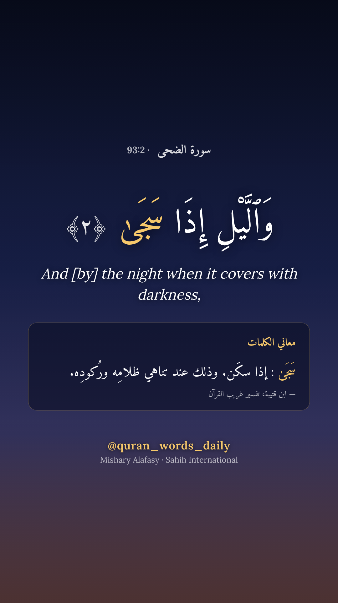

# quran-reels

Open-source pipeline behind **Quran Words Daily**: two Quran passages a day as vertical reels
(reading in order in the morning, a theme such as the Quran's supplications in the evening,
Surah Al-Kahf on Fridays), with Mishary Alafasy's recitation, the Uthmani text, the Sahih International English
translation and the meaning of its difficult words from Ibn Qutaybah's *Tafsir Gharib al-Qur'an*.

Published on Facebook, Instagram, TikTok and YouTube Shorts as `@quran_words_daily`.



## Principles

- No Quran text, translation or explanation is ever written by AI. Everything comes from
  published, referenced editions.
- Every video credits the reciter, the translation and the word-meaning source.
- Free and open-source tooling only: Python, ffmpeg, Chromium, GitHub Actions.

## Usage

Requires Python 3.11+, ffmpeg and Chromium for Playwright.

```bash
pip install -e ".[dev]"
python -m playwright install chromium
quran-reels ingest                 # Quran text, translation, chapters, gloss index → .cache/
quran-reels render 93              # a short surah, whole → out/093_001-011.mp4
quran-reels passages 2             # a long one, split into passages of about a minute
quran-reels render 2:1-5           # → out/002_001-005.mp4
```

`quran-reels publish 93 --dry-run` renders and uploads to Facebook (left as a draft) and
Instagram (container not published); without `--dry-run` it posts. It reads `META_PAGE_ID`,
`META_PAGE_TOKEN` and `IG_USER_ID` from the environment and first checks that the Page token
can still access data for at least 14 days.

Passages last about a minute (40–90 s) and are only cut where a sentence ends and where
Ibn Kathir's commentary does not group ayahs together. A surah that fits in 90 s is rendered
whole.

`render` downloads whatever is missing from the cache (glosses and recitation of the passage).
`quran-reels ingest --all-glosses` fetches every Ibn Qutaybah entry at once (about 2,400
requests, throttled and resumable). Next to the video, `out/093_001-003/` holds the image
layers, previews, the caption and a `manifest.json` that lists every text shown with its
edition and source.

Data sources: [Quran.com API](https://api.quran.com/api/v4) (Uthmani text, Sahih
International), [tafsir.app](https://tafsir.app) (Ibn Qutaybah, *Tafsir Gharib al-Qur'an*),
[EveryAyah](https://everyayah.com) (recitations).

## Status

Work in progress: rendering works, publishing does not yet. See [`CLAUDE.md`](CLAUDE.md) for the architecture and decisions
(in French) and [`docs/plateformes.md`](docs/plateformes.md) for platform constraints.

## Credits

Fonts: Amiri Quran, Amiri (Khaled Hosny) and Lora, under the SIL Open Font License
(see `assets/fonts/`). Quran data, translation, tafsir and recitations belong to their
respective publishers and are downloaded at build time, not redistributed here.

## License

Code: MIT.
